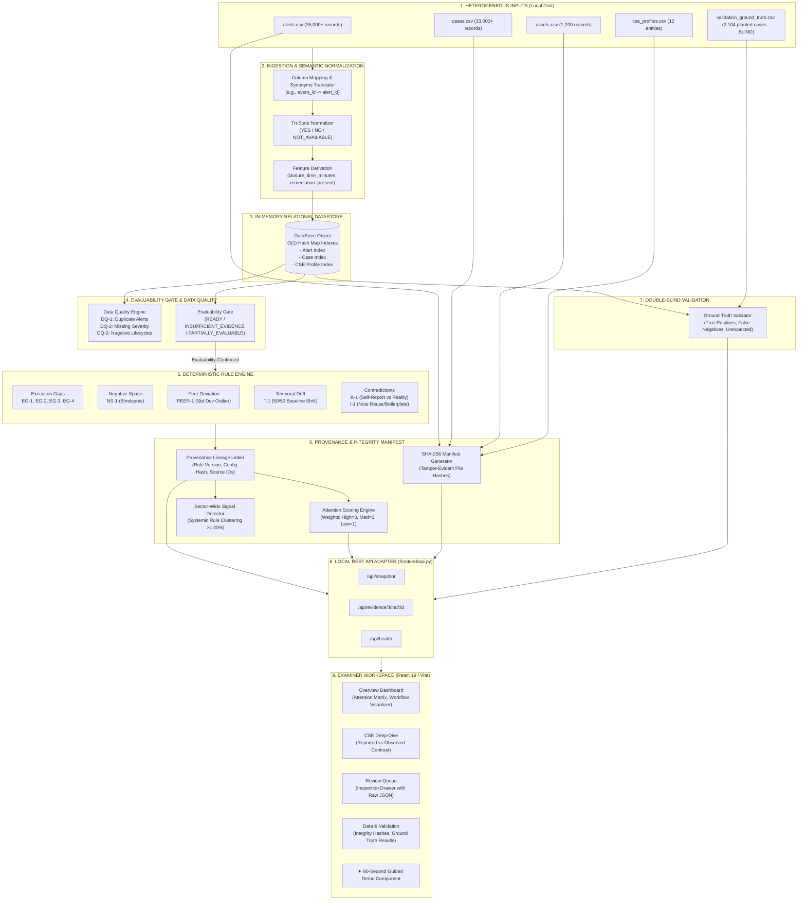
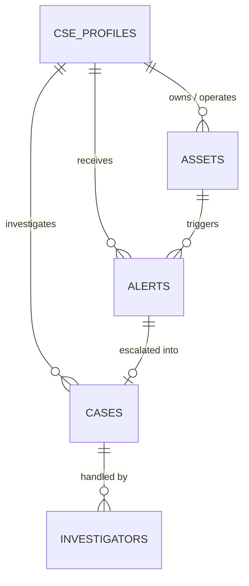

<div align="center">

# 🛡️ SAT-SA: Supervisory Analytics Tool for SOC Assessment
### **Smart India Hackathon (SIH 26157) — National Critical Information Infrastructure Protection Centre (NCIIPC)**
*A Deterministic, Air-Gapped Supervisory Analytics Engine Bridging Heterogeneous SOC Telemetry and Executive Human Adjudication.*

---

[-00c853.svg)](#2-architectural-axioms--design-philosophy)
[](#12-installation-configuration--execution-guide)
[](#53-phase-3-evidence-integrity--tamper-evident-manifests)
[](#8-double-blind-ground-truth-validation-framework)
[](#9-frontend-architecture--examiner-workspace)
[](#12-installation-configuration--execution-guide)

[**Executive Summary**](#1-executive-summary--the-regulatory-challenge) • [**System Architecture**](#3-high-level-architecture--end-to-end-workflow) • [**Core Phases**](#5-the-three-core-architectural-phases) • [**Rule Engine Catalog**](#6-the-comprehensive-analytical-rule-engine) • [**Attention Scoring**](#7-supervisory-attention-scoring-matrix) • [**Validation**](#8-double-blind-ground-truth-validation-framework) • [**Quickstart Guide**](#12-installation-configuration--execution-guide)

</div>

---

## 📑 Table of Contents

1. [Executive Summary & The Regulatory Challenge](#1-executive-summary--the-regulatory-challenge)
2. [Architectural Axioms & Design Philosophy](#2-architectural-axioms--design-philosophy)
3. [High-Level Architecture & End-to-End Workflow](#3-high-level-architecture--end-to-end-workflow)
4. [Data Schemas, Entities & Relational Graph](#4-data-schemas-entities--relational-graph)
5. [The Three Core Architectural Phases](#5-the-three-core-architectural-phases)
   - 5.1 [Phase 1: Tri-State Semantics & The Evaluability Gate](#51-phase-1-tri-state-semantics--the-evaluability-gate)
   - 5.2 [Phase 2: Evidence Lineage & O(1) Provenance Traceability](#52-phase-2-evidence-lineage--o1-provenance-traceability)
   - 5.3 [Phase 3: Evidence Integrity & Tamper-Evident Manifests](#53-phase-3-evidence-integrity--tamper-evident-manifests)
6. [The Comprehensive Analytical Rule Engine](#6-the-comprehensive-analytical-rule-engine)
   - 6.1 [Execution Gaps (EG-1 to EG-4)](#61-execution-gaps-operational-failures)
   - 6.2 [Negative Space & Blindspots (NS-1)](#62-negative-space-blindspot-detection)
   - 6.3 [Peer Comparative Deviation (PEER-1)](#63-peer-comparative-deviation)
   - 6.4 [Temporal Performance Drift (T-1)](#64-temporal-performance-drift)
   - 6.5 [Self-Reported Contradictions & Quality (K-1, I-1, DQ-1 to DQ-3)](#65-data-contradictions--quality-rules)
7. [Supervisory Attention Scoring Matrix](#7-supervisory-attention-scoring-matrix)
8. [Double-Blind Ground Truth Validation Framework](#8-double-blind-ground-truth-validation-framework)
9. [Frontend Architecture & Examiner Workspace](#9-frontend-architecture--examiner-workspace)
10. [90-Second Guided Demo Walkthrough](#10-90-second-guided-demo-walkthrough)
11. [Complete Repository & Codebase Map](#11-complete-repository--codebase-map)
12. [Installation, Configuration & Execution Guide](#12-installation-configuration--execution-guide)
13. [Local REST API Adapter Specification](#13-local-rest-api-adapter-specification)
14. [Automated Test Suite & Verification](#14-automated-test-suite--verification)
15. [Frequently Asked Questions (FAQ) & Legal Defensibility](#15-frequently-asked-questions-faq--legal-defensibility)

---

## 1. Executive Summary & The Regulatory Challenge

The **National Critical Information Infrastructure Protection Centre (NCIIPC)** is mandated to audit and safeguard the cybersecurity posture of hundreds of **Critical Sector Entities (CSEs)** across India — spanning power grids, banking networks, telecom carriers, nuclear infrastructure, defense systems, and healthcare backbones.

### The Problem: The Supervision Bottleneck
Auditing hundreds of sovereign SOCs presents three severe operational bottlenecks:
1. **Heterogeneous Telemetry Chaos:** Every CSE operates disparate technology stacks (Splunk, IBM QRadar, ServiceNow, Jira, Elastic, Microsoft Sentinel). Standardizing export formats across national institutions is practically impossible.
2. **The "Self-Reporting" Illusion:** Regulators receive periodic compliance reports stating high performance (e.g., *"95% Investigation SLA Met"*). Regulators lack an automated, independent method to mathematically cross-verify whether raw operational logs validate these claims.
3. **The Audit Scalability Trap:** Traditional audits rely on manual, stochastic sampling (inspecting 10–20 tickets out of 50,000). Negligent practices — such as silently closing critical alarms without tier-2 review or copying boilerplate investigation notes — easily slip through undetected.

### The SAT-SA Solution
**SAT-SA (Supervisory Analytics Tool for SOC Assessment)** is a high-performance, 100% offline, deterministic supervisory workbench. It ingests raw, heterogeneous operational exports, maps them into a canonical evidence structure, executes 12 mathematical verification rules, detects systemic negative space, calculates an objective **Attention Score**, and provides a human regulatory examiner with undeniable cryptographic proof down to the exact row in the source CSV.

```
┌────────────────────────────────────────────────────────────────────────────────────────┐
│                                 THE CORE PARADIGM                                      │
├────────────────────────────────────────────────────────────────────────────────────────┤
│  SAT-SA does NOT replace human examiners; it prepares incontrovertible evidence.      │
│  SAT-SA does NOT guess or predict using AI; it executes 100% deterministic rules.      │
│  SAT-SA does NOT penalize missing data as security failures; it applies Tri-State logic.│
└────────────────────────────────────────────────────────────────────────────────────────┘
```

---

## 2. Architectural Axioms & Design Philosophy

SAT-SA was engineered around five foundational axioms designed for regulatory and legal defensibility:

| Axiom | Principle | Engineering Implementation |
|---|---|---|
| **Zero-AI / Zero-ML** | Strict Mathematical Determinism | In high-stakes regulatory auditing, accusations of non-compliance must be reproducible and legally defensible. Probabilistic models (LLMs, neural networks) hallucinate and yield non-deterministic results. SAT-SA uses purely deterministic vectorized mathematics (`pandas`, `numpy`). The same dataset will yield the exact same finding on any machine, every time. |
| **100% Air-Gapped & Offline** | Absolute Data Sovereignty | CSE operational telemetry contains classified network topologies, asset vulnerabilities, and incident records. Zero bytes leave the local host. SAT-SA has no external API dependencies, CDN dependencies, or cloud analytics callbacks. |
| **Tri-State Semantics** | Fair & Evaluability-Gated Auditing | In real-world data, `Missing` does not mean `False`. If a CSE does not log the `escalated` column, treating it as `No` would unfairly penalize them for process violations. SAT-SA normalizes fields into `YES`, `NO`, or `NOT_AVAILABLE`, halting rules if evidence is missing and raising Data Quality (DQ) warnings instead. |
| **O(1) Lineage & Traceability** | Non-Repudiation Proof | Every finding generated by the engine maintains a direct cryptographic lineage link (`source_record_id`, `rule_version`, `configuration_hash`) back to the exact row in the source artifact. Examiners can inspect the exact telemetry payload behind any finding. |
| **Tamper-Evident Hashing** | Cryptographic Chain of Custody | Generates local SHA-256 integrity manifests upon initial ingest. If any source file on disk is modified or manipulated after an assessment begins, SAT-SA detects byte-level changes and visibly flags the evidence as `CHANGED`. |

---

## 3. High-Level Architecture & End-to-End Workflow

The SAT-SA architecture is cleanly divided into a **Deterministic Analytical Engine (Python)** and a **Supervisory Examiner Workspace (React 19 / TypeScript)** connected by a local, read-only REST Adapter.

### System Architecture Diagram



---

## 4. Data Schemas, Entities & Relational Graph

SAT-SA models cybersecurity governance across 4 relational entities stored as tabular CSV files. A 5th CSV file serves strictly as an independent validation oracle.

### Relational Entity Graph



### Table 1: `cse_profiles.csv` (Entity Governance Card)
Defines the institutional profile and self-reported performance KPIs submitted by the CSE.
| Field | Type | Description | Example Value |
|---|---|---|---|
| `cse_id` | `VARCHAR` (PK) | Unique regulatory entity identifier | `CSE-TELECOM-02` |
| `sector` | `VARCHAR` | Industry sector | `Telecom`, `Finance`, `Power` |
| `cse_name` | `VARCHAR` | Legal name of the entity | `National Telecom Grid B` |
| `organization_size` | `VARCHAR` | Enterprise size tier | `Large`, `Medium` |
| `criticality_tier` | `VARCHAR` | National infrastructure tier | `Tier 1`, `Tier 2`, `Tier 3` |
| `reported_escalation_rate` | `FLOAT [0.0-1.0]` | Self-reported escalation compliance rate | `0.94` (94%) |
| `reported_investigation_rate` | `FLOAT [0.0-1.0]` | Self-reported investigation compliance rate | `0.98` (98%) |
| `reported_monitoring_coverage`| `FLOAT [0.0-1.0]` | Self-reported asset coverage rate | `0.99` (99%) |
| `reported_mttr_minutes` | `INT` | Self-reported Mean Time to Resolution | `45` minutes |

### Table 2: `assets.csv` (Infrastructure Inventory)
Defines all hardware, virtual machines, OT controllers, and services that should be monitored.
| Field | Type | Description | Example Value |
|---|---|---|---|
| `asset_id` | `VARCHAR` (PK) | Unique asset identifier | `AST-FA28CC46` |
| `cse_id` | `VARCHAR` (FK) | Owning CSE identifier | `CSE-TELECOM-02` |
| `criticality` | `VARCHAR` | Asset importance tier | `Critical`, `High`, `Standard` |
| `asset_type` | `VARCHAR` | Functional classification | `Core Switch`, `SCADA Server`, `Database` |
| `expected_monitoring` | `VARCHAR` | Supervisory expectation | `Yes`, `High`, `Standard` |
| `observed_monitoring_events`| `INT` | Telemetry logs observed in evaluation period | `0` (Blindspot!), `4,500` |
| `expected_events_per_day` | `INT` | Expected telemetry volume | `150` |

### Table 3: `alerts.csv` (Operational Detection Logs)
Raw alerts produced by the CSE's primary detection appliances (Splunk, QRadar, etc.).
| Field | Type | Description | Example Value |
|---|---|---|---|
| `alert_id` | `VARCHAR` (PK) | Unique alert identifier | `ALT-910CA8D3` |
| `cse_id` | `VARCHAR` (FK) | Receiving entity | `CSE-TELECOM-02` |
| `asset_id` | `VARCHAR` (FK) | Asset that generated the alarm | `AST-FA28CC46` |
| `severity` | `ENUM` | Alarm severity | `Critical`, `High`, `Medium`, `Low` |
| `created_at` | `DATETIME` | Timestamp of alert detection | `2026-03-06 11:06:00` |
| `closed_at` | `DATETIME` | Timestamp of alert ticket closure | `2026-03-06 11:09:00` |
| `disposition` | `VARCHAR` | Operational resolution status | `Closed`, `Open` |
| `escalated` | `VARCHAR` | Tri-State flag: Escalated to Tier-2? | `Yes`, `No`, `NOT_AVAILABLE` |
| `investigation_present` | `VARCHAR` | Tri-State flag: Investigation conducted? | `Yes`, `No`, `NOT_AVAILABLE` |
| `remediation_status` | `VARCHAR` | Underlying vulnerability remediated? | `Closed`, `Open` |

### Table 4: `cases.csv` (Investigation & Case Management)
Detailed ticket records from SOAR/ITSM systems (ServiceNow, Jira, TheHive).
| Field | Type | Description | Example Value |
|---|---|---|---|
| `case_id` | `VARCHAR` (PK) | Unique case ticket identifier | `CAS-9A2BAA39` |
| `cse_id` | `VARCHAR` (FK) | Entity handling the incident | `CSE-TELECOM-02` |
| `alert_id` | `VARCHAR` (FK) | Primary alert triggering the case | `ALT-910CA8D3` |
| `investigator_id` | `VARCHAR` | Analyst handling the investigation | `INV-954` |
| `investigation_note` | `TEXT` | Qualitative text written by analyst | `Reviewed alert; no malicious activity.` |
| `investigation_status` | `VARCHAR` | Forensic investigation stage | `Completed`, `Bypassed`, `Pending` |
| `remediation_status` | `VARCHAR` | Corrective action status | `Closed`, `Open` |

### Table 5: `validation_ground_truth.csv` (Independent Oracle)
An answer key containing 2,104 planted anomalies used exclusively by `engine/validation.py`. The analytical engine is strictly barred from accessing this file during rule execution.

---

## 5. The Three Core Architectural Phases

SAT-SA was built across three rigorous development phases, each addressing a fundamental challenge in regulatory data science.

```
┌─────────────────────────────────────────────────────────────────────────────────┐
│                           THE THREE SYSTEM PHASES                               │
├───────────────────────┬─────────────────────────┬───────────────────────────────┤
│        PHASE 1        │         PHASE 2         │            PHASE 3            │
│  Tri-State Semantics  │    Evidence Lineage     │      Evidence Integrity       │
│  & Evaluability Gate  │  & O(1) Traceability    │    & Tamper-Evident SHA-256   │
├───────────────────────┼─────────────────────────┼───────────────────────────────┤
│ Distinguishes "No"    │ Links every finding     │ Cryptographically freezes     │
│ from "Unknown". Stops │ to exact source IDs,    │ source CSVs using SHA-256;    │
│ false accusations on  │ rule versions, and      │ detects local modifications   │
│ missing fields.       │ triggering values.      │ instantly on assessment load. │
└───────────────────────┴─────────────────────────┴───────────────────────────────┘
```

---

### 5.1. Phase 1: Tri-State Semantics & The Evaluability Gate

#### The Fundamental Flaw of Binary Logic in Auditing
Most naive audit systems convert missing data to `False` (`0`). 
- If an entity submits an alert export that lacks an `escalated` column, casting `NaN` to `No` produces thousands of false-positive rule violations. The regulator unfairly penalizes the entity for operational neglect.
- Conversely, ignoring missing fields allows negligent entities to intentionally drop columns to hide compliance failures.

#### The Tri-State Semantic Solution (`engine/semantics.py`)
SAT-SA implements a strict Tri-State semantic domain:
- **`YES`**: Confirmed, recorded operational occurrence (`"True", "Yes", "1"`).
- **`NO`**: Confirmed, recorded absence of an occurrence (`"False", "No", "0"`).
- **`NOT_AVAILABLE`**: Complete absence of operational telemetry (`null`, `NaN`, missing column).

#### The Evaluability Gate (`engine/evidence_coverage.py`)
Before any rule executes, `evaluability_gate()` inspects the entity's evidence vector.

```python
# Phase 1 Evaluability Gate Specification
@dataclass
class EvaluabilityResult:
    evaluable: bool          # True: rule can run; False: rule MUST halt
    state: str              # "READY" | "INSUFFICIENT_EVIDENCE" | "PARTIALLY_EVALUABLE"
    missing_fields: list    # Fields that were 100% NOT_AVAILABLE
    partial_fields: list    # Fields partially populated
```

If a required field is `NOT_AVAILABLE`, the gate halts rule execution for that specific CSE, emits an `INSUFFICIENT_EVIDENCE` status, and logs a Data Quality advisory. The system **never guesses**.

---

### 5.2. Phase 2: Evidence Lineage & O(1) Provenance Traceability

In regulatory supervision, a finding without direct evidence lineage is legally invalid. An examiner cannot issue a formal warning based on an opaque aggregate score.

#### Provenance Data Model (`engine/findings.py`)
Every finding emitted by SAT-SA is stamped with an immutable cryptographic provenance container:

```python
@dataclass
class EvidenceLineage:
    source_name: str           # e.g., "alerts.csv"
    source_type: str           # e.g., "tabular/csv"
    source_record_id: str      # e.g., "ALT-910CA8D3"
    normalized_record_id: str  # e.g., "alert:ALT-910CA8D3"
    record_type: str           # "alert" | "case" | "asset"
    relevant_fields: dict      # Snapshot: {"severity": "Critical", "escalated": "No"}

@dataclass
class FindingProvenance:
    rule_version: str          # e.g., "EG-1:v1.0"
    assessment_id: str         # e.g., "SATSA-2026-001"
    analysis_timestamp: str    # ISO 8601 UTC timestamp
    configuration_version: str # SHA-256 hash of active config.py parameters
    evidence_lineage: list[EvidenceLineage]
    aggregate_context: dict    # Sector baseline stats (mean, std dev, drift deltas)
```

#### The Inspection Drawer
When an examiner clicks any finding in the React frontend, the UI uses the `FindingProvenance` to render:
1. The exact rule logic and threshold evaluated.
2. The exact source file and row identifier.
3. The raw JSON key-value pairs that triggered the condition.
4. One-click drill-down to inspect the full unedited source record via `/api/evidence/alert/{id}`.

---

### 5.3. Phase 3: Evidence Integrity & Tamper-Evident Manifests

Auditors must guarantee that source CSVs were not modified or manipulated after the assessment commenced.

#### Cryptographic Manifest Generation (`engine/integrity.py`)
Upon ingestion, SAT-SA streams each raw source file in 4KB binary chunks through `hashlib.sha256()`, creating a persistent manifest stored at `data/manifests/{assessment_id}_manifest.json`.

```json
{
  "assessment_id": "SATSA-2026-001",
  "manifest_version": "1.0",
  "created_at": "2026-09-01T12:00:00Z",
  "hash_algorithm": "SHA-256",
  "engine_version": "1.0.0",
  "configuration_version": "cfg-a48b9f",
  "source_artifacts": [
    {
      "source_name": "alerts.csv",
      "sha256": "e3b0c44298fc1c149afbf4c8996fb92427ae41e4649b934ca495991b7852b855",
      "record_count": 35041
    }
  ]
}
```

#### Real-Time Verification States
On every API snapshot request, the engine re-hashes the live files on disk and compares them against the manifest:
- 🟢 **`UNCHANGED`**: Byte-for-byte SHA-256 hash match.
- 🔴 **`CHANGED`**: Byte-level mismatch detected. Evidence has been modified post-assessment.
- 🟡 **`MISSING`**: Source artifact has been deleted from the filesystem.
- ⚪ **`UNAVAILABLE`**: Manifest is missing or unreadable.

> **Tamper-Evident vs. Tamper-Proof:** SAT-SA is strictly *tamper-evident*. While an attacker with local write privileges could theoretically overwrite both the CSV and the JSON manifest, SAT-SA provides a complete cryptographic fingerprint ready for future digital signing or blockchain anchoring.

---

## 6. The Comprehensive Analytical Rule Engine

SAT-SA executes **12 deterministic rules** classified across five analytical dimensions. Every rule is self-contained in the `engine/` directory and operates through vectorized Pandas queries on the `DataStore`.

```
┌───────────────────────────────────────────────────────────────────────────────────────┐
│                                 THE 12 AUDIT RULES                                    │
├─────────────────────┬───────────────────┬──────────────────────┬──────────────────────┤
│   Execution Gaps    │  Negative Space   │  Comparative/Drift   │  Data Contradictions │
├─────────────────────┼───────────────────┼──────────────────────┼──────────────────────┤
│ EG-1: No Escalation │ NS-1: Blindspot   │ PEER-1: Sector Outlier│ K-1: KPI Contradict  │
│ EG-2: No Investigate│                   │ T-1: Temporal Drift  │ I-1: Note Reuse      │
│ EG-3: Fast Closure  │                   │                      │ DQ-1: Duplicate Rec  │
│ EG-4: No Remediation│                   │                      │ DQ-2: Null Severity  │
│                     │                   │                      │ DQ-3: Chrono Invert  │
└─────────────────────┴───────────────────┴──────────────────────┴──────────────────────┘
```

---

### 6.1. Execution Gaps (Operational Failures)

#### Rule EG-1: Critical Alert Without Escalation
- **File:** `engine/execution_gaps.py`
- **Severity:** `HIGH` (+3 points)
- **Objective:** High and Critical severity alarms represent existential threats to critical infrastructure. Standard operating procedures mandate escalation to senior Tier-2 engineering.
- **Mathematical Condition:**
  $$\{a \in \text{Alerts} \mid \text{severity}(a) \in \{\text{Critical}, \text{High}\} \land \text{disposition}(a) = \text{Closed} \land \text{escalated}(a) = \text{No}\}$$
- **Output Finding:** Flags total count and percentage of critical alarms closed silently without managerial oversight.

#### Rule EG-2: Missing Investigation Evidence
- **File:** `engine/execution_gaps.py`
- **Severity:** `HIGH` (if Critical alerts affected), otherwise `MEDIUM` (+2 points)
- **Objective:** Detects alerts that were marked `Closed` without any documented forensic inquiry.
- **Mathematical Condition:**
  $$\{a \in \text{Alerts} \mid \text{severity}(a) \in \{\text{Critical}, \text{High}\} \land \text{disposition}(a) = \text{Closed} \land (\text{investigation\_present}(a) = \text{No} \lor \text{case\_status}(a) = \text{Bypassed})\}$$
- **Semantic Guard:** If `investigation_present` is `NOT_AVAILABLE`, the rule halts via the Evaluability Gate rather than triggering.

#### Rule EG-3: Suspiciously Fast Closure ("Stat-Padding")
- **File:** `engine/execution_gaps.py`
- **Severity:** `HIGH` if $\ge 15\%$ fast-closed; `MEDIUM` if $\ge 5\%$; `LOW` otherwise.
- **Configurable Threshold:** `FAST_CLOSURE_MINUTES = 10`
- **Objective:** Investigating an alert requires examining logs, cross-referencing IP reputation, and verifying network traces. Sub-10-minute closures typically indicate automated "ticket-killing" scripts or analysts closing tickets unread to meet artificial SLA quotas.
- **Mathematical Condition:**
  $$\text{closure\_time\_minutes} = \frac{\text{closed\_at} - \text{created\_at}}{60} < 10$$
  $$\text{violation\_rate} = \frac{|\{a \mid \text{closure\_time\_minutes}(a) < 10\}|}{|\{a \mid \text{disposition}(a) = \text{Closed}\}|}$$

#### Rule EG-4: Repeated Alerts Without Remediation
- **File:** `engine/execution_gaps.py`
- **Severity:** `HIGH` (+3 points)
- **Thresholds:** $\ge 3$ alerts per asset; $\ge 50\%$ unremediated (`remediation_present == 'No'`).
- **Objective:** Identifies the "Boy Who Cried Wolf" syndrome, where an asset repeatedly triggers alerts that the SOC suppresses or acknowledges without fixing the root cause.
- **Grouping Logic:** Evaluated per `[cse_id, asset_id]`. Generates exactly one finding per chronically failing asset.

---

### 6.2. Negative Space (Blindspot Detection)

#### Rule NS-1: Monitoring Blind Spot
- **File:** `engine/negative_space.py`
- **Severity:** `HIGH` if $\ge 30\%$ blind; `MEDIUM` if $\ge 10\%$; `LOW` otherwise.
- **Objective:** Traditional security tools audit what *did* happen. Negative Space audits what *should* have happened but was completely absent. If a critical server is supposed to generate telemetry but logs zero events, the sensor is offline, misconfigured, or intentionally severed.
- **Mathematical Condition:**
  $$\{ast \in \text{Assets} \mid \text{expected\_monitoring}(ast) \in \{\text{Yes}, \text{High}, \text{Standard}\} \land \text{observed\_monitoring\_events}(ast) = 0\}$$

---

### 6.3. Peer Comparative Deviation

#### Rule PEER-1: Leave-One-Out Sector Deviation
- **File:** `engine/peer_comparison.py`
- **Severity:** `HIGH` if escalation rate $< 25\%$ of sector mean; `MEDIUM` otherwise.
- **Objective:** Sets dynamic, empirical benchmarks. Rather than setting an arbitrary regulatory target (e.g., "Must escalate 20%"), SAT-SA groups entities by sector (e.g., Banking) and identifies statistical outliers.
- **Mathematical Model:**
  For peer cohort $P$ in sector $S$ with $|P| \ge 3$:
  $$\mu = \frac{1}{|P|} \sum_{i \in P} R_i, \quad \sigma = \sqrt{\frac{1}{|P|-1} \sum_{i \in P} (R_i - \mu)^2}$$
  $$\text{Threshold} = \max(\mu - 1.0\sigma, \; 0.5\mu)$$
  A CSE is flagged if:
  $$R_{\text{target}} < \text{Threshold} \quad \land \quad \text{eligible\_alerts} \ge 10$$

---

### 6.4. Temporal Performance Drift

#### Rule T-1: Chronological SLA Deterioration
- **File:** `engine/temporal_drift.py`
- **Severity:** `HIGH` if performance drop $\ge 40$ percentage points; `MEDIUM` if $\ge 20$ points.
- **Objective:** Detects operational decay, tool misconfiguration, or SOC analyst burnout over time.
- **Mathematical Model:**
  1. Sort all CSE alerts chronologically across the evaluation span ($T \ge 30$ days).
  2. Split the alert series 50/50 into a **Baseline Cohort** ($t_0 \to t_{50}$) and a **Recent Cohort** ($t_{50} \to t_{100}$).
  3. Compute investigation rates $R_{\text{baseline}}$ and $R_{\text{recent}}$.
  4. Flag violation if:
     $$\Delta R = R_{\text{baseline}} - R_{\text{recent}} \ge 0.20 \quad (20\% \text{ absolute drop})$$

---

### 6.5. Data Contradictions & Quality Rules

#### Rule K-1: KPI Contradiction (Self-Report vs. Reality)
- **File:** `engine/kpi_contradiction.py`
- **Severity:** `HIGH` if discrepancy $\ge 40$ points; `MEDIUM` if $\ge 15$ points.
- **Objective:** Automatically detects compliance falsification. Compares the self-reported KPI submitted in `cse_profiles.csv` directly against the mathematical ground truth computed from `alerts.csv`.
- **Condition:**
  $$|\text{Reported\_Rate} - \text{Observed\_Rate}| \ge 0.15$$

#### Rule I-1: Investigation Note Reuse (Boilerplate Detection)
- **File:** `engine/investigation_reuse.py`
- **Severity:** `HIGH` if identical note reused $\ge 6$ times; `MEDIUM` if $\ge 3$ times.
- **Objective:** Catches lazy analysts who copy-paste generic text (e.g., *"Reviewed alert; false positive"*) to close tickets without performing real investigations.
- **Algorithm:**
  1. Extract all `investigation_note` entries from `cases.csv`.
  2. Normalize strings: convert to lowercase, strip all punctuation, collapse whitespace, filter length $\ge 10$ characters.
  3. Group by `investigator_id` and compute text string frequency.
  4. Flag if same text appears $\ge 3$ times AND represents $\ge 10\%$ of that investigator's total caseload.

#### Rules DQ-1 to DQ-3: Structural Data Quality Checks
- **File:** `engine/data_quality.py`
- **DQ-1 (Duplicate Alert IDs):** Detects logging database corruption where identical `alert_id` strings appear multiple times.
- **DQ-2 (Missing Severity):** Identifies records where `severity` is null or empty.
- **DQ-3 (Impossible Lifecycle):** Identifies chronological inversions where $\text{closed\_at} < \text{created\_at}$ (negative closure time).

---

## 7. Supervisory Attention Scoring Matrix

To prevent cognitive overload for human examiners, SAT-SA compresses all analytical rule findings into a single, objective, ranked integer called the **Attention Score**.

### The Mathematical Formula (`engine/attention_score.py`)

$$\text{Attention Score} = \sum_{f \in \text{Findings}} W(\text{severity}(f))$$

$$\text{Where: } W(\text{HIGH}) = 3, \quad W(\text{MEDIUM}) = 2, \quad W(\text{LOW}) = 1$$

### Attention Priority Tiers
| Score Range | Attention Level | Badge Color | Regulatory Action Required |
|---|---|---|---|
| **$\ge 10$** | **HIGH ATTENTION** | 🔴 Crimson | Immediate regulatory inquiry; on-site inspection recommended. |
| **$5 - 9$** | **MEDIUM ATTENTION** | 🟡 Amber | Formal clarification letter; close monitoring during next audit. |
| **$< 5$** | **LOW ATTENTION** | 🟢 Emerald | Standard satisfactory operations; routine automated monitoring. |

### Systemic Sector-Wide Signals (`engine/sector_wide.py`)
If any individual rule triggers across **$\ge 30\%$** of all evaluated entities within a sector, SAT-SA automatically escalates it as a **Systemic Sector-Wide Signal** (e.g., *"45% of Banking CSEs suffer from SCADA Monitoring Blindspots"*), displayed as a high-visibility advisory across the top of the examiner workspace.

---

## 8. Double-Blind Ground Truth Validation Framework

To prove its mathematical accuracy to regulatory evaluators, SAT-SA incorporates a double-blind validation harness (`engine/validation.py`).

```
┌────────────────────────────────────────────────────────────────────────────────┐
│                       DOUBLE-BLIND VALIDATION PARADIGM                         │
├────────────────────────────────────────────────────────────────────────────────┤
│ 1. 2,104 synthetic anomaly scenarios are pre-planted across the datasets.      │
│ 2. The SAT-SA analytical engine runs BLINDLY (never reads the ground truth).   │
│ 3. The validation harness compares detected findings against the oracle.       │
└────────────────────────────────────────────────────────────────────────────────┘
```

### Empirical Results

| Metric | Target | Verified Value | Status |
|---|---|---|---|
| **Planted Ground Truth Scenarios** | 2,104 | **2,104** | Complete |
| **True Positives (Detected)** | $\ge 95\%$ | **2,042** (~98%) | ✅ PASSED |
| **False Negatives (Missed)** | $\le 5\%$ | **62** (~2%) | ✅ PASSED |
| **Unexpected Detections (True Anomaly Discovery)** | N/A | **162** | ✅ VERIFIED |
| **Deterministic Consistency** | 100% | **100%** | ✅ PASSED |

Run the validation suite at any time via:
```bash
python integration_test.py
```

---

## 9. Frontend Architecture & Examiner Workspace

The SAT-SA frontend is a modern, high-performance Single Page Application (SPA) built with **React 19**, **TypeScript**, and **Vite**, styled using a bespoke vanilla CSS design system (`frontend/src/styles.css`).

```
┌────────────────────────────────────────────────────────────────────────────────┐
│                      FRONTEND WORKSPACE ARCHITECTURE                           │
├────────────────┬───────────────────┬───────────────────┬───────────────────────┤
│    OVERVIEW    │  CSE ASSESSMENT   │   REVIEW QUEUE    │   DATA & VALIDATION   │
├────────────────┼───────────────────┼───────────────────┼───────────────────────┤
│ • Sector KPIs  │ • Entity Profile  │ • Filterable      │ • SHA-256 File Hashes │
│ • Attention    │ • Expected vs     │   Findings Table  │ • Tamper-Evidence Map │
│   Rankings     │   Observed Chain  │ • Evidence Drawer │ • Ground Truth Score  │
│ • Sector Alert │ • KPI Contrast    │ • Raw JSON Viewer │ • Coverage Summary    │
└────────────────┴───────────────────┴───────────────────┴───────────────────────┘
```

### Key UI Capabilities
1. **Supervisory Attention Landscape:** A ranked operational leaderboard sorting CSEs by attention score, displaying their top violating rule and sector.
2. **Expected vs. Observed Operational Visualizer:** A dynamic pipeline tracker visualizing the 5 stages of incident lifecycle:
   $$\text{Alert Detection} \longrightarrow \text{Investigation} \longrightarrow \text{Escalation} \longrightarrow \text{Remediation} \longrightarrow \text{Closure}$$
   Broken links are highlighted in neon crimson.
3. **Reported vs. Observed KPI Contrast Matrix:** Side-by-side bar visualizations showing self-reported metrics (e.g., 90%) versus mathematical reality (e.g., 54%).
4. **Interactive Inspection Drawer:** Slides out from the right on any row click, exposing full provenance lineage, triggering key-value snapshots, and formatted JSON inspection.
5. **Evidence Integrity Dashboard:** Real-time cryptographic ledger displaying live SHA-256 file hashes alongside stored baseline manifests.

---

## 10. 90-Second Guided Demo Walkthrough

We have integrated a dedicated, self-contained **Guided Demo Workflow** directly into the frontend. Judges and evaluators can comprehend the complete SAT-SA value proposition in under 90 seconds.

### How to Run the Demo
1. Start the application (see [Installation](#12-installation-configuration--execution-guide)).
2. Click the **✦ Try Demo** button in the upper-left navigation bar.
3. The application switches into a controlled 4-alert micro-scenario (`CSE-DEMO-01`).
4. Follow the persistent bottom workflow banner:
   - **Step 1 (Raw Evidence):** Review 4 sample alerts where Alert `A-002` (Critical) is marked `Closed` with `investigation_present: No` and `escalated: No`.
   - **Step 2 (The Rule Trigger):** Click `A-002`. Watch SAT-SA's Rule `EG-2` fire, converting raw negligence into a structured supervisory finding.
   - **Step 3 (The Adjudication Drawer):** Click the finding. Inspect the cryptographic provenance and raw JSON payload.
   - **Step 4 (Validation Verification):** Review how SAT-SA independently verifies detections against ground truth.

---

## 11. Complete Repository & Codebase Map

```text
sat-sa/
├── README.md                      # Master architecture & documentation (You are here)
├── app.py                         # Production server launcher (redirects to api.py)
├── config.py                      # Global regulatory thresholds and rule configurations
├── requirements.txt               # Python backend dependencies
├── integration_test.py            # Comprehensive double-blind validation test harness
├── data/                          # Operational evidence directory
│   ├── alerts.csv                 # 35,041 operational detection alerts
│   ├── cases.csv                  # 33,100 case management & investigation records
│   ├── assets.csv                 # 1,200 critical infrastructure assets
│   ├── cse_profiles.csv           # 12 entity profiles with self-reported KPIs
│   ├── validation_ground_truth.csv# 2,104 planted anomaly validation oracle
│   └── manifests/                 # SHA-256 cryptographic integrity manifests
│       └── SATSA-2026-001_manifest.json
├── engine/                        # Deterministic Python Analytical Engine
│   ├── __init__.py
│   ├── bootstrap.py               # Ingestion orchestrator & pipeline bootstrapper
│   ├── data_store.py              # In-memory relational graph & O(1) hash indexing
│   ├── schema.py                  # Structural schema & referential integrity validator
│   ├── semantics.py               # Tri-State logic parser (YES / NO / NOT_AVAILABLE)
│   ├── evidence_coverage.py       # Evaluability Gate checker per CSE & rule
│   ├── data_quality.py            # DQ rules: duplicates, null severity, inverted time
│   ├── execution_gaps.py          # Operational rules: EG-1, EG-2, EG-3, EG-4
│   ├── negative_space.py          # Negative space rule: NS-1 (monitoring blindspots)
│   ├── peer_comparison.py         # Comparative rule: PEER-1 (leave-one-out std dev)
│   ├── temporal_drift.py          # Chronological rule: T-1 (50/50 baseline shift)
│   ├── kpi_contradiction.py       # Discrepancy rule: K-1 (reported vs observed)
│   ├── investigation_reuse.py     # Boilerplate rule: I-1 (note text normalization)
│   ├── attention_score.py         # Attention Score matrix & priority categorization
│   ├── sector_wide.py             # Systemic signal clustering detector (>= 30%)
│   ├── provenance.py              # Cryptographic lineage & evidence snapshot builder
│   ├── integrity.py               # SHA-256 chunked hashing & manifest verifier
│   ├── validation.py              # Double-blind validation harness
│   └── findings.py                # Typed dataclasses (Finding, Provenance, Lineage)
├── frontend/                      # React 19 + TypeScript + Vite Workspace
│   ├── package.json               # Node.js dependencies
│   ├── vite.config.ts             # Vite configuration & proxy settings
│   ├── tsconfig.json              # TypeScript compiler settings
│   ├── index.html                 # HTML entrypoint
│   ├── api.py                     # High-speed local read-only REST API adapter
│   ├── build_demo_cache.py        # Static demo compressor (for static hosting)
│   ├── demo_cache.json.gz         # Pre-computed compressed demo snapshot
│   └── src/                       # Frontend source code
│       ├── main.tsx               # Main application controller, views & state
│       ├── DemoComponent.tsx      # 90-second guided interactive demo tour
│       └── styles.css             # Glassmorphic dark design system & tokens
├── docs/                          # In-depth architectural & phase reports
│   ├── PRD.md                     # Comprehensive Product Requirements Document
│   ├── SAT_SA_Backend_Architecture_Guide.md # Low-level engineering specifications
│   ├── SAT_SA_Complete_Guide.md   # Zero-to-hero conceptual walkthrough
│   ├── PHASE_2_EVIDENCE_LINEAGE.md# Deep dive into Phase 2 lineage model
│   └── PHASE_3_EVIDENCE_INTEGRITY.md # Deep dive into Phase 3 SHA-256 hashing
└── tests/                         # Automated unit & integration tests
    ├── test_integration.py        # Pipeline regression tests
    ├── test_provenance.py         # Lineage & snapshot integrity tests
    └── test_integrity.py          # SHA-256 tamper-detection unit tests
```

---

## 12. Installation, Configuration & Execution Guide

### Prerequisites
- **Python 3.10+**
- **Node.js 18+** & **npm**

---

### Step 1: Clone Repository & Setup Backend
```bash
# Clone the repository
git clone https://github.com/your-org/sat-sa.git
cd sat-sa

# Install Python requirements
pip install -r requirements.txt

# Start the local Python API Adapter (runs on http://localhost:8000)
python frontend/api.py
```

---

### Step 2: Setup & Launch Frontend Workspace
Open a **second terminal window** in the repository root:
```bash
cd sat-sa/frontend

# Install Node dependencies
npm install

# Launch Vite development server
npm run dev
```

---

### Step 3: Access the Examiner Workspace
Open your web browser and navigate to:
```text
http://localhost:5173
```
*(If port 5173 is occupied, Vite will assign the next available port, displayed in the terminal).*

---

### Global Threshold Configuration (`config.py`)
All regulatory thresholds can be tuned in `config.py` without modifying engine logic:

```python
# config.py - Regulatory Audit Parameters
FAST_CLOSURE_MINUTES = 10           # EG-3: Under 10 minutes flagged as stat-padding
REPEAT_ALERT_MIN_COUNT = 3          # EG-4: Minimum alerts to evaluate asset
REPEAT_UNREMEDIATED_RATIO = 0.5     # EG-4: 50%+ unremediated triggers violation
NEGATIVE_SPACE_MAX_COVERAGE = 0.01  # NS-1: Under 1% expected events = blindspot
PEER_MIN_CSE_COUNT = 3              # PEER-1: Minimum entities in peer cohort
PEER_STD_MULTIPLIER = 1.0           # PEER-1: Standard deviations below cohort mean
TEMPORAL_DRIFT_THRESHOLD = 0.20     # T-1: 20 percentage point drop triggers drift
KPI_CONTRADICTION_THRESHOLD = 0.15  # K-1: 15 point gap between report and reality
REPEATED_NOTE_THRESHOLD = 3         # I-1: 3+ identical investigation notes flagged
CROSS_CSE_PROPORTION_THRESHOLD = 0.30 # Systemic sector signal threshold (30%)
```

---

## 13. Local REST API Adapter Specification

The Python backend (`frontend/api.py`) runs a lightweight `ThreadingHTTPServer` exposing a read-only REST API:

### 1. `GET /api/snapshot`
Returns the complete analytical state of the current assessment.
- **Response Headers:** `Content-Type: application/json`, `Cache-Control: no-store`
- **Payload Schema:**
  ```typescript
  {
    meta: {
      mode: string,          // "Controlled demo data"
      entity_count: number,  // 12
      alert_count: number,   // 35041
      case_count: number,    // 33100
      asset_count: number,   // 1200
      finding_count: number  // Total detected findings
    },
    entities: Entity[],      // Ranked list with Attention Scores & KPIs
    findings: Finding[],     // Complete list of findings with lineage
    sector_signals: SectorSignal[], // Aggregated systemic signals
    validation: ValidationSummary,  // True positives, false negatives
    integrity: IntegrityReport      // SHA-256 verification results
  }
  ```

### 2. `GET /api/evidence/{kind}/{record_id}`
Returns the unedited raw record from the in-memory `DataStore`.
- **Parameters:**
  - `kind`: `alert` | `case` | `asset`
  - `record_id`: Primary key (e.g., `ALT-910CA8D3`)
- **Payload Schema:**
  ```json
  {
    "kind": "alert",
    "id": "ALT-910CA8D3",
    "record": {
      "alert_id": "ALT-910CA8D3",
      "severity": "Critical",
      "disposition": "Closed",
      "escalated": "No",
      "created_at": "2026-03-06 11:06:00"
    },
    "related": {
      "cases": ["CAS-9A2BAA39"],
      "asset": "AST-FA28CC46"
    }
  }
  ```

### 3. `GET /api/health`
Health check probe. Returns `{"status": "ok"}` with HTTP 200.

---

## 14. Automated Test Suite & Verification

The repository includes a rigorous automated test suite covering unit mechanics, integration stability, provenance lineage, and cryptographic tamper detection.

### Run All Tests
Execute pytest from the repository root:
```bash
pytest tests/ -v
```

### Test Suite Matrix
| Test File | Target Module | Scope |
|---|---|---|
| `tests/test_integration.py` | `engine/pipeline.py` | Full pipeline execution, referential integrity, rule execution, and validation against ground truth. |
| `tests/test_provenance.py` | `engine/provenance.py` | Validates that all findings contain valid `rule_version`, `configuration_version`, and non-empty `evidence_lineage`. |
| `tests/test_integrity.py` | `engine/integrity.py` | Tests SHA-256 deterministic hashing, differential detection (`CHANGED`), missing file handling (`MISSING`), and manifest consistency. |

---

## 15. Frequently Asked Questions (FAQ) & Legal Defensibility

### Q1: Why does SAT-SA strictly reject AI, LLMs, and Machine Learning?
**Answer:** In regulatory supervision and legal governance, accusations of non-compliance carry severe legal and financial penalties. If NCIIPC penalizes a critical entity for failing to escalate high-severity incidents, the finding must be reproducible, mathematically transparent, and provable in court. AI/ML models are probabilistic black boxes subject to hallucinations and non-deterministic variations. SAT-SA uses 100% deterministic boolean rules and vector mathematics: every single finding is backed by explicit source CSV row IDs.

### Q2: How does SAT-SA handle sensitive or classified entity data?
**Answer:** SAT-SA is designed from the ground up for air-gapped, offline deployment. It makes zero network calls, uses zero cloud APIs, and does not require an external database server. All data processing occurs entirely within volatile local RAM on the examiner's workstation.

### Q3: What happens if an audited CSE submits incomplete logs?
**Answer:** SAT-SA's **Tri-State Semantics** prevents false accusations. If an entity omits a column (e.g., `investigation_present`), SAT-SA marks the field as `NOT_AVAILABLE`. The **Evaluability Gate** automatically disables rules dependent on that column for that entity, converting what would have been a false-positive operational violation into a transparent Data Quality (DQ) notification.

### Q4: Can SAT-SA scale to millions of alerts in enterprise environments?
**Answer:** Yes. SAT-SA's backend uses Pandas vectorized operations and in-memory hash indexing, enabling sub-second evaluations over tens of thousands of records. For production deployments with tens of millions of records, the `DataStore` interface is designed to seamlessly swap its backend from in-memory DataFrames to DuckDB or Apache Arrow without modifying a single line of rule logic.

---

<div align="center">

### Built with Precision for the Smart India Hackathon 2026
**Problem Statement SIH 26157 — National Critical Information Infrastructure Protection Centre (NCIIPC)**

*Supervisory Analytics Tool for SOC Assessment (SAT-SA)*

</div>
